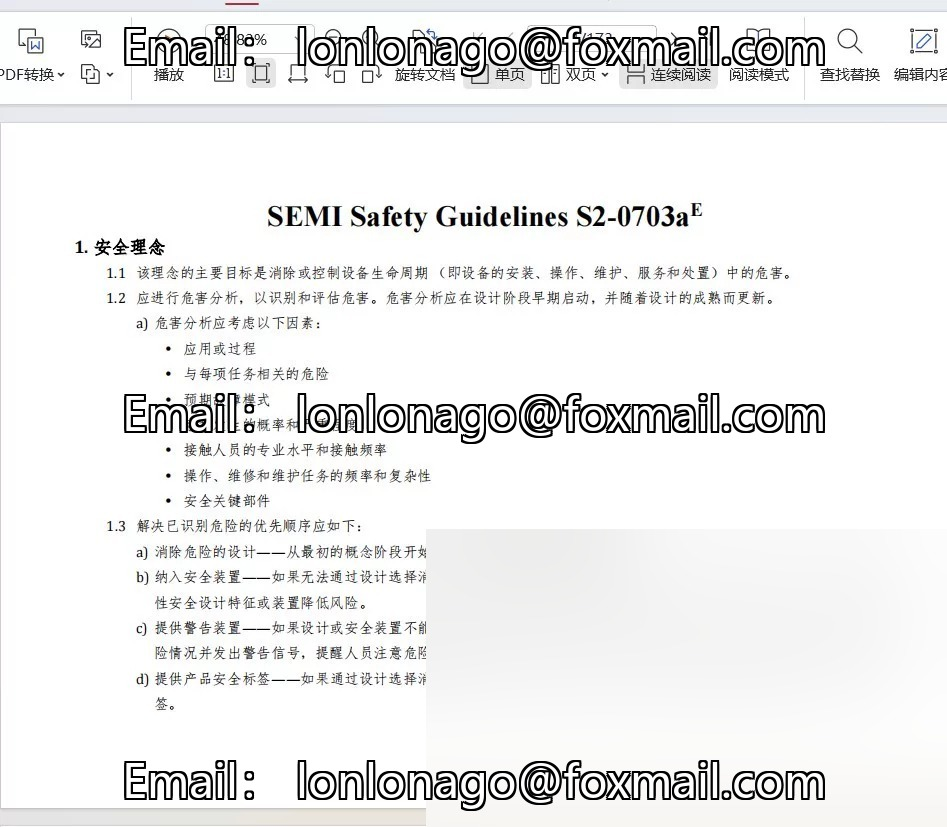
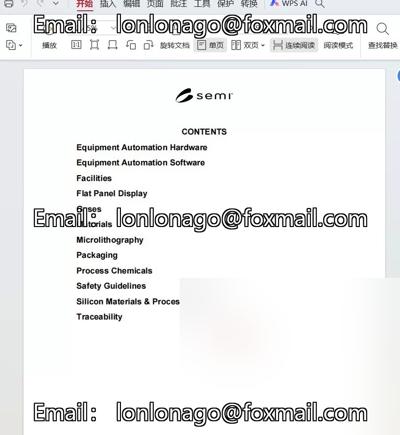
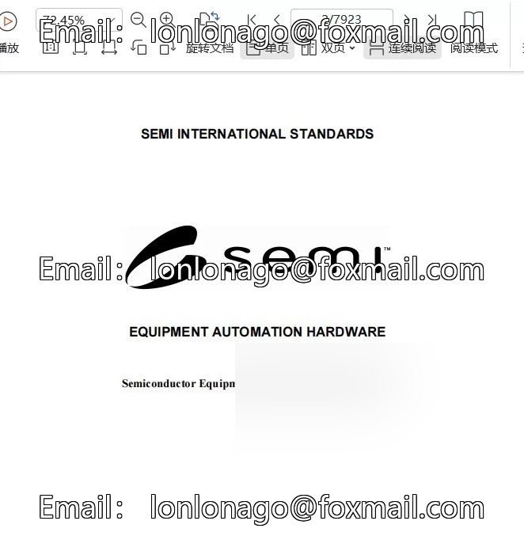
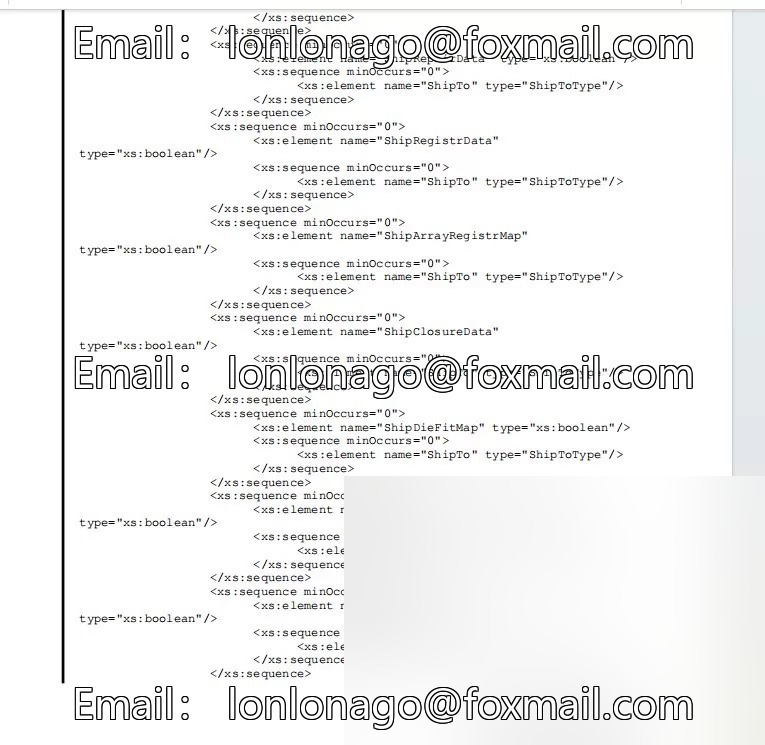
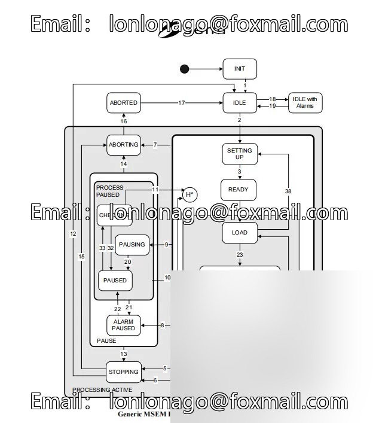
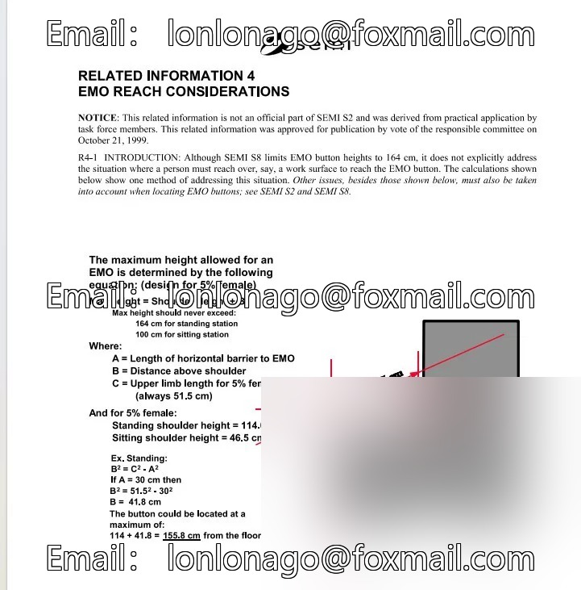

# Semiconductor industry specifications - extremely detailed - over 7900 pages, rich content, to understand the semiconductor

## Body

Semiconductor industry standards - very detailed - over 7900 pages with abundant content, of great value for understanding semiconductor industry processing and standards

Take a photo and immediately send the electronic original file! The following images are screenshots of the file directory. Confirm before placing the order! Due to the replicability of electronic filing materials, So after purchase, returns are not allowed! Thanks for understanding!

The material covers semiconductor industry rules, file directory screenshots and safety-related content, and notes that the original electronic file can be obtained directly while purchase is not eligible for return.

<!-- AI_ENRICHED -->

## Images

## Payment

Here is a pay link on Stripe ( https://buy.stripe.com/3cs8yP7sY87d0vu9AB ). Please contact me lonlonago@foxmail.com after funding $89, and I will send you a complete data files , thank you!

